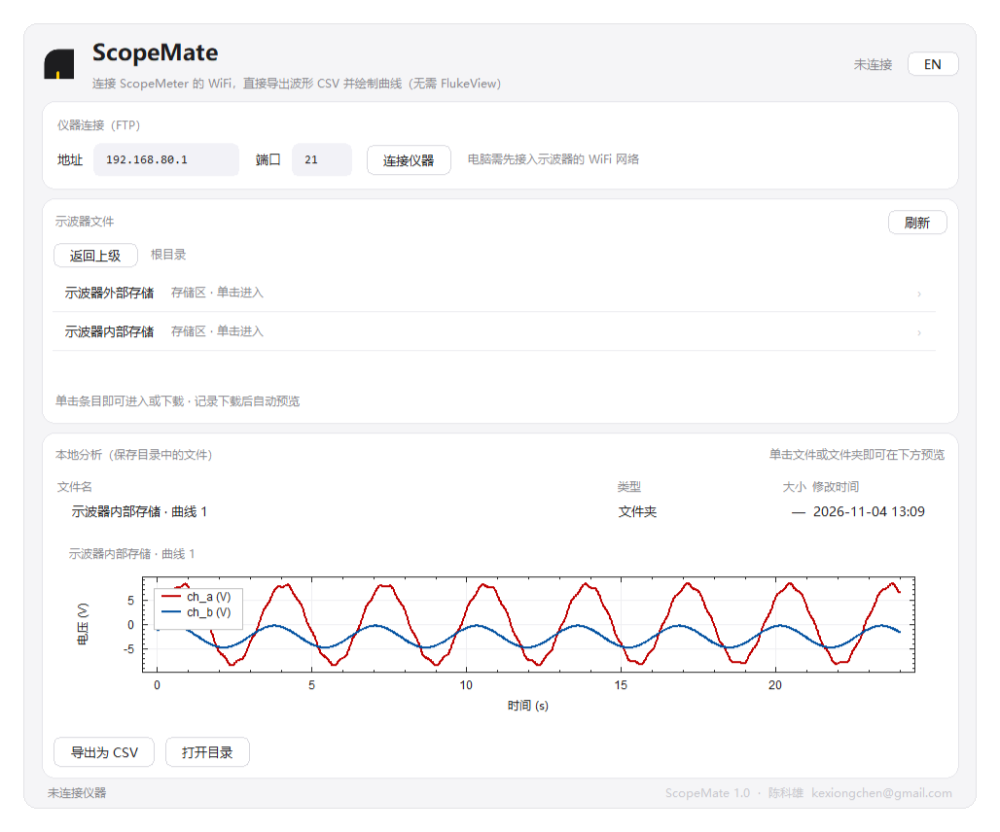

# ScopeMate

[中文](#中文) · [English](#english)

连接福禄克 ScopeMeter 120B 系列（如 Fluke 124B）的 WiFi，直接从仪器导出波形数据
并绘制示波器曲线，**无需安装 FlukeView**。

单文件、零第三方依赖，纯 Python 标准库实现。



## 特性

- **无需 FlukeView** —— 直接走仪器自带的匿名 FTP 服务
- **文件夹级工作流** —— 界面不按文件表展示，而是按仪器本身的组织方式呈现：
  根目录只有「示波器内部存储」「示波器外部存储」两个存储区，进入后是
  「曲线 1 ~ 20」条目（若仪器里给记录起过名字，则显示「曲线 N · 名字」，
  名字取自 `index.txt`）。单击存储区进入、单击曲线即自动整包下载
  （曲线数据 + `chA-srInfo` 等时间轴信息文件）并在主窗口内绘出曲线
- **原生格式解码** —— 仪器原生波形记录（`sr-chA-*` 文件）已完整解码：int16 A/B
  交织采样流，电压 = 原始值 × 0.0625 − 47.5 V（经与 FlukeView 导出数据逐点比对，
  残差为 0）；导出为 `time_s, ch_a_V, ch_b_V` 格式的 CSV
- **CSV 导出** —— 选中文件夹或记录文件一键导出 CSV（就近保存在记录所在
  文件夹）；CSV 也可直接预览绘图
- **专业曲线预览** —— 主窗口下方即预览区，Origin 风格：白底、黑色坐标框、
  向内主/次刻度、独立图例框、A/B 通道红蓝区分；十字光标读值、滚轮缩放、
  拖拽平移、双击复位；上万点数据自动抽稀，流畅渲染
- **极简操作** —— 曲线下方只有「导出为 CSV」和「打开目录」两个按钮；
  连接按钮任何时候都可点击（连接中=取消，已连接=断开并中止当前操作）
- **中英双语** —— 一键切换，界面文字全部跟随
- **Apple 风格浅色界面** —— 圆角卡片布局，高分屏 DPI 感知

## 支持型号

120B 系列（123B / 124B / 125B 等）搭配 WiFi USB 适配器（FLUKE-124B 套件附带）
的机型。其他型号未验证，欢迎反馈。

## 使用方法

1. 电脑接入示波器发出的 WiFi 网络（直连模式下仪器默认地址为 `192.168.80.1`）
2. 运行 `python ScopeMate.py`，或直接双击打包好的 `dist\ScopeMate.exe`，点击「连接仪器」
3. 在「示波器文件」中先单击「示波器内部存储」（或外部存储）进入，再**单击一条
   曲线**（「曲线 1」~「曲线 20」）：软件自动把该记录的整个文件夹（曲线数据 +
   `chA-srInfo` 等时间轴信息文件）下载到软件所在目录的 `waveforms` 文件夹，
   并直接在下方绘出曲线；界面上的「返回上级」可逐层回退
4. 曲线下方两个按钮：「导出为 CSV」把当前记录导出为 CSV（保存在记录所在
   文件夹内），「打开目录」在资源管理器中打开对应文件夹
5. 本地列表中单击任意文件夹 / 记录文件同样直接预览；断开仪器后历史记录
   照样可预览、可导出（数据都在 `waveforms` 文件夹里，跟着软件走）
6. 卡住或想中止？「连接仪器」按钮任何时刻可点：连接中点击=取消连接，
   已连接时点击=断开并中止当前传输

> 同名记录不会互相覆盖：若本地已存在 `internal_1`，但里面已有的文件与这次下载的
> 不同（例如换了另一台仪器，或该槽位重新录制过），软件会另存为 `internal_1(1)`，
> 旧记录原封不动；只有当文件集合完全一致时（同一条记录重复下载）才原地更新。

> 采样间隔说明：曲线文件本身不含时间轴，但同目录的 `chA-srInfo` 保存了记录的
> 起止时刻（秒 + 毫秒），软件按 `间隔 = (结束 − 起始) / (采样点数 − 1)` 推算，
> 让首尾两点正好落在起止时刻上（详见「时间轴的来源与验证」）。下载记录时软件会自动一并下载
> `chA-srInfo`；若该文件缺失，则回退到默认 20 ms。

程序为**便携式设计**：下载的数据与设置文件（`settings.json`）都保存在
软件 / exe 所在目录旁边，换电脑或 U 盘携带时数据跟着软件走。

自行打包 exe：

```
python -m PyInstaller --noconfirm --onefile --windowed --name ScopeMate ^
  --icon assets\logo.ico --add-data "assets;assets" ScopeMate.py
```

## 仪器原生格式说明

仪器 FTP 上的记录文件按**文件名前缀**分两类：

- `sr-chA-*`（**示波器记录**，ScopeRecord）：小端 int16 裸采样流，A/B 交织，
  可直接绘制曲线、换算导出电压 CSV
- `mr-chA-*`（**仪表记录**，MeterRecord）：72 字节统计单元序列
  （4B 窗口号 + 64B 数据，数据区含 min/avg/max 原始计数），
  换算 `电压 = 原始值 × 0.0001`，每个单元代表 0.5 s 时间窗
  （经与 FlukeView 导出的数据逐点比对验证）；软件可绘制 Min/Avg/Max
  三条曲线并导出电压 CSV

示波器记录（`internal/1/sr-chA-*`，无扩展名）为**小端 int16 原始采样流，
无文件头**，A/B 两路按 `[A0, B0, A1, B1, ...]` 交织存储，电压换算：

```
电压(V) = 原始值 × 0.0625 − 47.5
```

- `0.0625 V/LSB` 与 FlukeView 导出 CSV 的数值一致（逐点残差为 0），且在不同
  垂直档位下不变（前级增益固定，V/div 只是显示层概念）；
- 零点 `760 LSB`（= 47.5 V / 0.0625）出现在 `setup.cfg` / `chA-srInfo` 的标定块中；
- 即使示波器屏幕只显示 A 通道，交织流中的第二路（B 输入）也真实存在——
  B 未接表笔时拾取串扰与工频干扰，属正常现象；
- 采样间隔不在曲线文件里，但同目录的 `chA-srInfo` 保存了记录的起止时刻，
  软件据此反推（见下节「时间轴的来源与验证」）。

## 时间轴的来源与验证

曲线文件只有采样点，没有任何时间字段。时间轴来自同目录的 `chA-srInfo`：

| 偏移 | 内容 |
|---|---|
| 1152 | 起始「秒」（int32，小端） |
| 1156 | 起始「毫秒」（int32，小端） |
| 1168 | 结束「秒」（int32，小端） |
| 1172 | 结束「毫秒」（int32，小端） |

```
采样间隔 = (结束时刻 − 起始时刻) / (采样点数 − 1)   # 首尾两点正好压在起止时刻上
```

实测 `internal/1`（16164 点）：起始 `946700889 s + 254 ms`，结束
`946701212 s + 681 ms`，共 16163 个采样间隔。

| 算法 | 总时长 | 间隔 | 末点时刻 |
|---|---|---|---|
| 秒 + 毫秒，÷(点数−1)（ScopeMate） | 323.427 s | 20.010334 ms | 323.427 s，与记录结束时刻一致 |
| 仅整秒，÷点数（FlukeView） | 323 s | 19.982678 ms | 322.980 s，比结束时刻早 0.447 s |

作为交叉验证：FlukeView 导入同一条记录后，其保存的
`XResolution = 0.0199827 s`，恰好等于「整秒差 ÷ 点数」（323 / 16164），
与上表第二行吻合到 7 位有效数字——说明该值同样来自 `chA-srInfo` 的秒字段，
既丢掉了毫秒、又少算一个采样间隔，因此与记录的真实结束时刻差约 0.45 s。
ScopeMate 把毫秒计入、并按「点数 − 1」分配，末点与记录结束时刻严格对齐
（跨 300 秒的记录，丢掉毫秒本身就会带来约 0.13% 的误差）。

`internal/2`（960 点）同样验证：`19.338 s ÷ 959 = 20.164750 ms`。

**不做档位归整**：早期版本会把结果吸附到 20 ms 这类标准档位，看起来更整齐，
但会把两条记录之间真实存在的差异（20.010 与 20.165，相差 0.77%）抹平，
导致横轴总长与记录的起止时刻不符。现在直接使用实测值，因此导出的 CSV 中
时间步长可能是 `0.020010` 这样的数值，而非整数档位；末行时间则正好等于
记录的结束时刻。

若 `chA-srInfo` 缺失（例如只单独拷走了曲线文件），软件回退到默认 20 ms。

Fluke 未公开 `.fvr` 录制文件格式，ScopeMate 对此类文件仍采用黑盒启发式解析
（float32 / int16 电压块扫描）。若某个文件解析异常，欢迎提 issue 并附上
结构转储输出（在 Python 里调用 `fvr_structure_dump()` 会生成头部 hex 与数据块
清单），请勿附上原始测量数据。

## 相关开源项目

福禄克仪器的第三方工具早有先例（本项目与其无代码往来，实现完全独立）：

- [ccrause/fluketrace](https://github.com/ccrause/fluketrace)（Pascal，MPL-2.0）：
  Fluke 120 系列，串口读取 Trace A/B 与 PostScript 截屏
- [eddic/flukereader](https://github.com/eddic/flukereader)（Python）：早期
  ScopeMeter 串口读取脚本
- [JimHokanson/fluke_scopemeter_matlab](https://github.com/JimHokanson/fluke_scopemeter_matlab)
  （MATLAB）：ScopeMeter 通信示例
- [anachrocomputer/ScopeMeter99](https://github.com/anachrocomputer/ScopeMeter99)：
  ScopeMeter 99 Series II 数据读取工具
- [zach-edf/fluke-app](https://github.com/zach-edf/fluke-app)（Python）：BLE 手持
  万用表的桌面端 / CLI / SDK
- [jb08brownie/Fluke189Controller](https://github.com/jb08brownie/Fluke189Controller)
  （Python）：Fluke 189 红外串口上位机

ScopeMate 的差异：面向 120B 系列的 **WiFi + FTP** 通道，直接读取仪器内存中的
原生记录文件（`sr-*` / `mr-*`）并解码，无需串口线，也无需 FlukeView。

## 开源与法律说明

- **独立实现**：ScopeMate 由作者独立编写。项目中不含、也未复制 FlukeView 或任何
  第三方软件的源代码、资源文件、二进制文件，也不含来自厂商安装包的片段。
- **结论的可复现性**：文中所有格式与换算结论，都可由**仪器自身产生的东西**独立
  复现——即仪器 FTP 服务对外提供的文件（`sr-chA-*`、`chA-srInfo` 等）以及仪器与
  上位机之间的网络交互现象。读者用同一台仪器即可验证每一条结论。
- **接口与格式**：网络协议、文件布局这类**功能性事实**通常不构成著作权保护的
  对象（受保护的是具体表达，例如源码与资源）。本项目只描述为互通所必需的格式，
  未复制任何受保护的表达。
- **不使用破解手段**：软件只使用仪器自身提供的匿名 FTP 服务，不需要密钥、不修改
  固件、不绕过任何访问控制或授权机制。
- **商标**："Fluke"、"ScopeMeter"、"FlukeView" 是 Fluke Corporation 的商标。
  本项目与该公司无任何关联，未获其赞助或背书；项目命名 ScopeMate 特意避开其
  商标，文中提及仅用于说明兼容性。
- **不分发专有文件**：本工具不包含、也不分发 Fluke 的固件、驱动、手册或安装包。
- **不含真实测量数据**：仓库内的截图与示例数据均为合成的演示波形，不含任何现场
  测量记录。提交 issue 时请同样避免附带真实数据。
- **使用责任**：请仅在您拥有或已获授权使用的仪器上使用本软件。软件按"现状"
  提供，作者不对使用后果承担责任。

## 运行环境

- Python 3.8+（仅标准库，无需 `pip install`）
- Windows / macOS / Linux（主要在 Windows 下测试）

```bash
python ScopeMate.py
```

## 许可

[MIT License](LICENSE) · Copyright (c) 2026 陈科雄 <kexiongchen@gmail.com>

---

<a id="english"></a>

# ScopeMate (English)

[中文](#中文) · **English**

Read waveforms straight from a Fluke ScopeMeter 120B series (e.g. 124B) over its
built-in WiFi and plot them, **without installing FlukeView**.

Single file, no third-party dependencies — pure Python standard library.


## Features

- **No FlukeView needed** — talks to the instrument's own anonymous FTP service
- **Folder-level workflow** — the UI mirrors the instrument instead of showing a
  file table: the root lists *Scope internal memory* / *Scope external memory*;
  inside are *Curve 1 … 20* (shown as *Curve N · name* when the record has a name
  in `index.txt`). Click a storage to enter, click a curve to download the whole
  record folder (samples + `chA-srInfo` time base) and plot it right away
- **Native decoding** — ScopeRecord files (`sr-chA-*`) are little-endian int16
  samples, A/B interleaved, voltage = `raw × 0.0625 − 47.5 V` (verified
  point-by-point against FlukeView exports, residual 0); exported as
  `time_s, ch_a_V, ch_b_V` CSV
- **CSV export** — one click exports the selected folder/record next to the
  source folder; CSV files can also be previewed
- **Professional plot** — embedded Origin-style panel: white canvas, black
  frame, inward major/minor ticks, boxed legend, red/blue channels; crosshair
  readout, wheel zoom, drag to pan, double-click to reset; automatic min/max
  decimation for large records
- **Minimal UI** — only *Export CSV* and *Open Folder* under the plot; the
  connect button is always clickable (while connecting = cancel; when connected
  = disconnect and abort the current transfer)
- **Bilingual** — switch between Chinese and English with one click
- **Portable** — downloaded data and `settings.json` live next to the exe

## Supported models

120B series (123B / 124B / 125B …) with the WiFi USB adapter (bundled with the
FLUKE-124B kit). Other models are untested — feedback welcome.

## Usage

1. Join the WiFi network broadcast by the instrument (default address
   `192.168.80.1` in direct mode)
2. Run `python ScopeMate.py`, or double-click the packaged `dist\ScopeMate.exe`,
   then click *Connect*
3. In *Scope Files*, click *Scope internal memory* (or external), then
   **click a curve** (*Curve 1 … 20*): the whole record folder (samples +
   `chA-srInfo`) is downloaded into the `waveforms` folder next to the app and
   plotted below. Use *Up* to go back level by level
4. The two buttons under the plot: *Export CSV* writes a CSV next to the record,
   *Open Folder* opens that folder in Explorer
5. Clicking any local folder/record previews it too — historical records remain
   usable after disconnecting (everything lives in `waveforms`)
6. Stuck? The connect button can be clicked at any time: while connecting it
   cancels, while connected it disconnects and aborts the transfer

> Same-name records are never overwritten: if `internal_1` already exists but
> its files differ from the new download (another instrument, or the slot was
> re-recorded), the app saves it as `internal_1(1)` and keeps the old copy. Only
> when the file set is identical (re-downloading the same record) does it
> update in place.

> Sample interval: the record file has no time axis, but `chA-srInfo` in the
> same folder stores the start/end time (seconds + milliseconds). The app uses
> `interval = (end − start) / (samples − 1)`, so the first and last samples sit
> exactly on the recorded timestamps (see *Time axis* below). `chA-srInfo` is
> downloaded automatically; if it is missing, the app falls back to 20 ms.

Portable by design: data and settings stay next to the app/exe, so a USB stick
or another PC carries everything along.

Building the exe yourself:

```
python -m PyInstaller --noconfirm --onefile --windowed --name ScopeMate ^
  --icon assets\logo.ico --add-data "assets;assets" ScopeMate.py
```

## Native formats

Records on the instrument's FTP server come in two families:

- `sr-chA-*` (**ScopeRecord**): raw little-endian int16 samples, A/B
  interleaved — plotted directly and exported as voltage CSV
- `mr-chA-*` (**MeterRecord**): a sequence of 72-byte statistics units
  (4 B window index + 64 B data holding min/avg/max counts),
  `voltage = raw × 0.0001`, each unit covering a 0.5 s window (verified against
  FlukeView exports); plotted as Min/Avg/Max and exported as CSV

A ScopeRecord (`internal/1/sr-chA-*`, no extension) is a **headerless raw
little-endian int16 stream**, A/B interleaved as `[A0, B0, A1, B1, …]`:

```
Voltage (V) = raw × 0.0625 − 47.5
```

- `0.0625 V/LSB` matches FlukeView's exported CSV (zero residual point by
  point) and does not change with the vertical range (front-end gain is fixed;
  V/div is a display concept only)
- the zero point `760 LSB` (= 47.5 V / 0.0625) appears in the calibration block
  of `setup.cfg` / `chA-srInfo`
- even when the screen only shows channel A, the second (interleaved) channel
  really exists — with nothing connected it picks up crosstalk and mains hum
- the sample interval is not stored in the sample file; it is reconstructed
  from the start/end timestamps in `chA-srInfo`

## Time axis

The sample file has no time field; `chA-srInfo` in the same folder provides:

| Offset | Content |
|---|---|
| 1152 | start seconds (int32, LE) |
| 1156 | start milliseconds (int32, LE) |
| 1168 | end seconds (int32, LE) |
| 1172 | end milliseconds (int32, LE) |

```
interval = (end − start) / (samples − 1)     # first/last sample on the timestamps
```

Measured on `internal/1` (16 164 samples): start `946700889 s + 254 ms`, end
`946701212 s + 681 ms` → 16 163 intervals.

| Method | Duration | Interval | Last sample |
|---|---|---|---|
| seconds + ms, ÷(n−1) (ScopeMate) | 323.427 s | 20.010334 ms | 323.427 s, exactly the end time |
| integer seconds, ÷n (FlukeView) | 323 s | 19.982678 ms | 322.980 s, 0.447 s early |

Cross-check: FlukeView stores `XResolution = 0.0199827 s` for the same record,
which is exactly `323 / 16164` — the integer-second difference divided by the
sample count. In other words it drops the milliseconds *and* misses one
interval, so it ends 0.45 s before the recorded end time. ScopeMate keeps the
milliseconds and divides by `n − 1`, so the last sample lands exactly on the
end timestamp (for a 300 s record, dropping milliseconds alone is a ~0.13 %
error).

`internal/2` (960 samples) checks out the same way: `19.338 / 959 =
20.164750 ms`.

**No snapping to nominal steps.** Earlier versions rounded the result to steps
such as 20 ms for tidier axes, but that flattened the real 0.77 % difference
between records (20.010 vs 20.165) and made the axis length disagree with the
recorded duration. The measured value is used as-is, so the CSV may contain
steps like `0.020010`; the last row equals the recorded end time.

If `chA-srInfo` is missing (e.g. only the sample file was copied), the app
falls back to 20 ms.

Fluke has not published the `.fvr` recording format, so those files are still
handled with a black-box heuristic (float32 / int16 voltage block scanning).
If a file parses badly, please open an issue with the structure dump
(`fvr_structure_dump()` in Python prints header hex and data blocks) — never
attach real measurement data.

## Related open-source projects

Third-party tools for Fluke instruments exist (no code shared with this
project; ScopeMate is an independent implementation):

- [ccrause/fluketrace](https://github.com/ccrause/fluketrace) (Pascal, MPL-2.0):
  Fluke 120 series over serial, Trace A/B and PostScript screen dumps
- [eddic/flukereader](https://github.com/eddic/flukereader) (Python): early
  ScopeMeter serial reader
- [JimHokanson/fluke_scopemeter_matlab](https://github.com/JimHokanson/fluke_scopemeter_matlab)
  (MATLAB): ScopeMeter communication examples
- [anachrocomputer/ScopeMeter99](https://github.com/anachrocomputer/ScopeMeter99):
  ScopeMeter 99 Series II reader
- [zach-edf/fluke-app](https://github.com/zach-edf/fluke-app) (Python): desktop
  app / CLI / SDK for BLE handheld multimeters
- [jb08brownie/Fluke189Controller](https://github.com/jb08brownie/Fluke189Controller)
  (Python): Fluke 189 over infrared serial

ScopeMate differs by using the **WiFi + FTP** channel of the 120B series:
records (`sr-*` / `mr-*`) are read from the instrument's memory and decoded
directly — no serial cable, no FlukeView.

## License and legal notes

- **Independent implementation**: ScopeMate was written independently. It does
  not contain or copy source code, resources or binaries from FlukeView or any
  third party, nor any fragment of vendor installers.
- **Reproducible conclusions**: every format and conversion in this document can
  be verified using only what the instrument itself produces — the files its FTP
  server offers (`sr-chA-*`, `chA-srInfo`, …) and the network interaction
  between the instrument and a host. Anyone with the same instrument can check
  each statement.
- **Interfaces and formats**: network protocols and file layouts are functional
  facts and generally not subject to copyright (copyright protects a specific
  expression, such as source code or artwork). This project documents only what
  interoperability requires and copies no protected expression.
- **No circumvention**: the app uses only the instrument's own anonymous FTP
  service — no keys, no firmware modification, no bypassing of access control.
- **Trademarks**: "Fluke", "ScopeMeter" and "FlukeView" are trademarks of Fluke
  Corporation. This project is not affiliated with, sponsored or endorsed by
  Fluke; the name ScopeMate deliberately avoids their marks, and they are used
  here only to describe compatibility.
- **No proprietary files distributed**: no Fluke firmware, drivers, manuals or
  installers are included or shipped.
- **No real measurement data**: screenshots and sample data in this repository
  are synthetic demo waveforms; please do not attach field data to issues.
- **Responsibility**: use this software only with instruments you own or are
  authorized to use. It is provided "as is", without warranty of any kind.

## Requirements

- Python 3.8+ (standard library only, no `pip install`)
- Windows / macOS / Linux (mainly tested on Windows)

```bash
python ScopeMate.py
```

## License

[MIT License](LICENSE) · Copyright (c) 2026 陈科雄 <kexiongchen@gmail.com>
